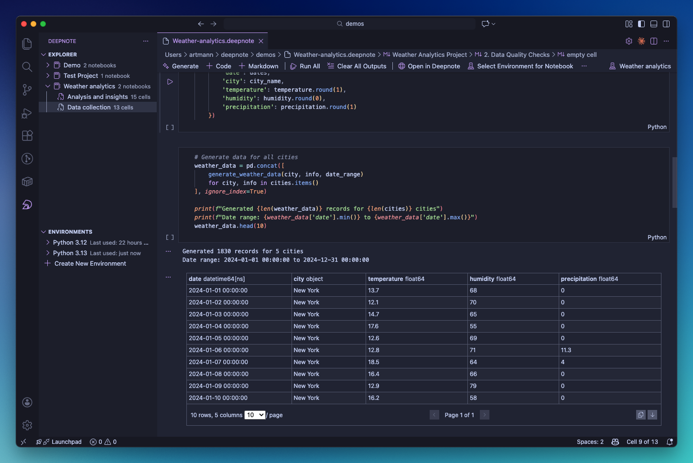

<div align="center">


[](https://github.com/deepnote/vscode-deepnote/actions/workflows/ci.yml)
[](https://codecov.io/gh/deepnote/vscode-deepnote)
[](https://marketplace.visualstudio.com/items?itemName=Deepnote.vscode-deepnote)

[Website](https://deepnote.com/?utm_source=github&utm_medium=github&utm_campaign=github&utm_content=readme_main) • [Docs](https://deepnote.com/docs?utm_source=github&utm_medium=github&utm_campaign=github&utm_content=readme_main) • [Changelog](https://deepnote.com/changelog?utm_source=github&utm_medium=github&utm_campaign=github&utm_content=readme_main) • [X](https://x.com/DeepnoteHQ) • [Examples](https://deepnote.com/explore?utm_source=github&utm_medium=github&utm_campaign=github&utm_content=readme_main) • [Community](https://github.com/deepnote/deepnote/discussions)

</div>

# Deepnote in VS Code, Cursor, Windsurf, and Antigravity

A powerful [Visual Studio Code](https://marketplace.visualstudio.com/items?itemName=Deepnote.vscode-deepnote), [Cursor](https://open-vsx.org/extension/Deepnote/vscode-deepnote), [Windsurf](https://open-vsx.org/extension/Deepnote/vscode-deepnote), and [Antigravity](https://open-vsx.org/extension/Deepnote/vscode-deepnote) extension that brings [Deepnote](https://deepnote.com/) notebook capabilities directly into your favorite editor. Work with sleek AI notebooks featuring SQL blocks, database integrations, and reactive blocks - all within your IDE.



Run Deepnote locally inside your IDE and unlock the next generation of data workflows:

- **Rich block types:** Combine Python, Markdown, data visualizations, tables, and more — all in one place
- **SQL blocks:** Run SQL queries out of the box, no extensions needed
- **Native database connections:** Securely connect to Snowflake, BigQuery, Postgres, and 60+ other sources via VS Code’s encrypted SecretStorage API
- **Init notebooks:** Auto-run setup code (dependencies, env setup) before execution
- **Smart requirements:** Generate `requirements.txt` automatically for reproducible runs
- **Deepnote kernel:** Fully `.ipynb` compatible, tuned for modern data workflows
- **Cloud collaboration:** Switch between local VS Code and Deepnote Cloud to collaborate live on the same file with your team

## Getting started

1. Open the extensions tab and Search for Deepnote
2. Or alternatively, press `Cmd+P` or `Ctrl+P` to open the command palette.
3. Type `ext install Deepnote.vscode-deepnote`
4. Press Enter

Or install from the [VS Code Marketplace](https://marketplace.visualstudio.com/items?itemName=Deepnote.vscode-deepnote)

### Requirements

- **Visual Studio Code** 1.95.0 or higher
- **Python** 3.10 or higher (for running notebooks)

### Opening your first Deepnote notebook

1. Open a folder containing `.deepnote` project files
2. Look for the Deepnote icon in the Activity Bar (sidebar)
3. Click on a notebook in the Deepnote Explorer to open it
4. Select a Python kernel when prompted
5. Start coding!

## Usage

### Command palette

Open the Command Palette (`Cmd+Shift+P` or `Ctrl+Shift+P`) and type `Deepnote` to see all available commands:

| Command                                            | Description                                                             |
| -------------------------------------------------- | ----------------------------------------------------------------------- |
| `Deepnote: Refresh Explorer`                       | Refresh the Deepnote project explorer                                   |
| `Deepnote: Open Notebook`                          | Open a specific notebook from a Deepnote project                        |
| `Deepnote: Open File`                              | Open the raw .deepnote project file                                     |
| `Deepnote: Reveal in Explorer`                     | Show active notebook information in the explorer                        |
| `Deepnote: Show Project Explorer`                  | Show the Deepnote sidebar and select the active notebook when available |
| `Deepnote: Manage Integrations`                    | Configure database connections and credentials                          |
| `Deepnote: New Project`                            | Create a new Deepnote project                                           |
| `Deepnote: Import Notebook`                        | Import an existing notebook into your project                           |
| `Deepnote: Set API Token`                          | Save a Deepnote API token for syncing and publishing                    |
| `Deepnote: Clear API Token`                        | Remove the saved Deepnote API token                                     |
| `Deepnote: Sync with Deepnote Cloud`               | Sync a folder that is already synced with your Deepnote workspace       |
| `Deepnote: Sync a New Folder with Deepnote Cloud…` | Download your Deepnote workspace into a folder and start syncing it     |
| `Deepnote: Publish App…`                           | Publish a folder, such as an app's build output, as a Deepnote data app |
| `Deepnote: Preview App`                            | Preview a data app folder in the editor's built-in browser              |
| `Notebook: Select Notebook Kernel`                 | Select or switch kernels within your notebook                           |
| `Notebook: Change Cell Language`                   | Change the language of the cell currently in focus                      |
| `Deepnote: Enable Snapshots`                       | Enable snapshot mode for the current workspace                          |

### Syncing with Deepnote Cloud

To start, run `Deepnote: Sync a New Folder with Deepnote Cloud…` from the Command Palette or from the `…` menu of the Deepnote explorer, and choose a folder.

After that, run `Deepnote: Sync with Deepnote Cloud`, or click the sync button in the Deepnote explorer title bar. With one synced folder in your workspace, it syncs that folder. With several, it asks which one, listing the folder of the file you have open first. With none, it offers to sync a new folder.

- Sync uses `DEEPNOTE_TOKEN` from a `.env` file in the synced folder, or the token saved with `Deepnote: Set API Token`.
- The first sync into a folder downloads every project of your Deepnote workspace, one folder per project, and creates `.deepnote-sync.json`.
- Each sync pulls projects changed in Deepnote and pushes projects changed locally.
- Before overwriting changes that were not synced, sync asks, offering one replacement and "Skip":
  - For a project changed both locally and in Deepnote, or a local folder that already exists with different content where sync downloads a project, it offers to replace the local files with the Deepnote version.
  - For local edits that Deepnote rejects because the project changed there, it offers to replace the Deepnote version with the local files.
  - "Skip" leaves both copies as they are, and the next sync asks about that project again.
- Unsaved notebooks must be saved before a sync starts.
- Sync works only in a trusted workspace, in the desktop app, for a folder inside the open workspace that neither contains nor is inside another synced folder.
- Sync does not create Deepnote projects. Local `.deepnote` files that are not linked to a project are left as they are.
- Deleting a project folder or a notebook file locally does not delete it in Deepnote, and the next sync downloads it again.

Known limitations:

- Edits made in the folder while a sync runs can be overwritten.
- Saving a notebook after running cells writes its outputs into the file, so the next sync pushes that project.
- After a sync updates an open notebook, the editor can save the notebook again, and the next sync can then push that project or report a conflict for it.
- A folder reached through a symbolic link or junction is checked by its path in the workspace, not by its target, so a link into another synced folder is not refused.

### Publishing apps

Run `Deepnote: Publish App…` from the Command Palette, or right-click a folder in the file explorer and choose `Publish App…`. It uploads the folder to a Deepnote data app project and publishes the app, then shows the app URL with "Open" and "Copy". People with access to the project can open a published app; there is no anonymous or link-only access.

- The folder is published as it is. Build your app first, then publish its build output folder, such as `dist/`.
- Each file of the folder replaces the app file at the same path in Deepnote. Files you delete from the folder are not deleted in Deepnote and stay published; delete them in Deepnote.
- Only data app projects can be published to. When the folder is inside a synced project, the app goes to that project after one confirmation, and publishing fails if it is not a data app. Otherwise you choose one of your workspace's data apps, or "New Data App…" to create a data app project with the name you enter.
- The data app is remembered per folder, so publishing the folder again asks only for one confirmation, with "Change Settings…" to choose again.
- A data app calls Deepnote with a short-lived token scoped to the person viewing it, never your personal token.
- Publishing needs "Allow static file sharing in projects" turned on in the workspace settings.
- Publishing uses `DEEPNOTE_TOKEN` from a `.env` file in a synced folder above the app folder, or else the token saved with `Deepnote: Set API Token`. A folder that contains a `.env` or `.env.*` file cannot be published, because every published file can be served to the app's viewers.
- Publishing into a synced folder does not start while a sync or another such publish is in progress.
- For a folder inside a synced project, when app files changed in Deepnote since the last sync or publish, publishing asks first. "Force" overwrites them in Deepnote. "Sync First" syncs the whole synced folder with the working files of every project, which downloads Deepnote's versions of the app files into the synced project's `.files/_deepnote_static` folder, so you can merge them into your app and publish again. It also replaces the local copy of every working file that changed in Deepnote, so it is not offered for a folder that is in, or contains, a synced project's `.files` folder. A project with a working file over 100 MiB fails to sync this way. A folder outside a synced project overwrites app files changed in Deepnote without asking.
- Publishing needs a trusted workspace and the desktop app.

### Previewing apps

Run `Deepnote: Preview App` from the Command Palette, or right-click a folder in the file explorer and choose `Preview App`, to see the app before you publish it. The page opens in the editor's built-in browser, or in your system browser when the editor has none.

- The folder is served the way Deepnote serves a published app, from a local address. Edit a file and reload the page to see the change.
- The page's script tag for Deepnote's client (`https://deepnote.com/static/app-client/v1.js`) is replaced with the extension's own client, so the preview works without network access.
- `inputs()` returns the input blocks of the notebook with that ID in the workspace's `.deepnote` files, as saved on disk, so save the notebook and reload the page to see a change. An ID that no workspace notebook has rejects with `Notebook not found`.
- `run()` runs that notebook, as saved on disk, in a new kernel on the Deepnote server the extension runs for its `.deepnote` file: the project's init notebook first, then the notebook with the page's input values.
  - It uses the notebook's Python interpreter. Its SQL blocks use the integrations configured in VS Code, except BigQuery integrations that use Google OAuth.
  - Agent blocks run only when the model provider's API key, such as `OPENAI_API_KEY`, is set in VS Code's own environment. The key saved for agent cells is not used.
  - Like a run in Deepnote, it is not read-only: what its code writes, such as files or stored dataframes, is written.
  - A run keeps going until its notebook finishes, even after you close the preview. Reloading or closing the VS Code window stops it.
  - For a legacy `.deepnote` file that holds several notebooks, the first run shows the prompt to split the file, as opening the file does.
- `appData()` answers from that notebook's newest successful `run()` in the preview: the first JSON object the run displayed (an `application/json` output), the first agent block's answer, and when the run started. Until a run succeeds, it rejects with Deepnote's message. The preview keeps run results in memory, so reloading or closing the VS Code window clears them.
- `dataframe(name, { pageIndex, pageSize })` pages through the frame stored under that name in `deepnote_dataframes/<name>/` in the app's project folder, the folder of the `.deepnote` file nearest at or above the app folder. Pages and values match Deepnote's, but the preview does not apply Deepnote's limits on how much one page may hold.
  - The deepnote-toolkit version the extension installs does not store frames there yet: `store_dataframe(df, name)` writes them to `<home>/work/deepnote_dataframes/`, so the preview does not see them.
  - Reading a frame that deepnote-toolkit compressed with zstd needs an editor whose Node.js has zstd (22.15 or later).
- Previewing needs a trusted workspace and the desktop app.

### Database integrations

Configure database connections for SQL blocks:

1. Open Command Palette
2. Run `Deepnote: Manage Integrations`
3. Add your database credentials (PostgreSQL, BigQuery, etc.)
4. Use SQL blocks in your notebooks with the configured integrations

Credentials are securely stored using VS Code's encrypted storage and never leave your machine.

### Working with SQL Blocks

SQL blocks allow you to query databases directly from your notebooks:

```sql
-- Query your PostgreSQL database
SELECT * FROM users WHERE created_at > '2024-01-01'
```

Results are displayed as interactive tables that you can explore and export.

### Snapshot mode

Snapshot mode gives you a historical, portable record of all notebook executions without polluting your main project files. This makes it easier to work with Git since outputs are stored separately from your source code.

**How it works:**

- Execution outputs are saved to a `snapshots/` folder alongside your project
- Your main `.deepnote` file stays clean (no outputs), making diffs readable
- Each "Run All" execution creates a timestamped snapshot for historical tracking
- Running individual cells updates only the latest snapshot

**To enable:**

1. Open Command Palette (`Cmd+Shift+P` or `Ctrl+Shift+P`)
2. Run `Deepnote: Enable Snapshots`

Once enabled, snapshots are automatically created when you execute notebooks. You can add the `snapshots/` folder to `.gitignore` to keep outputs local, or commit them to share execution history with your team.

## Need help?

- Join our [Community](https://github.com/deepnote/deepnote/discussions)!
- Open an [Issue](https://github.com/deepnote/vscode-deepnote/issues) for bug reports or feature requests
- Have a look at [Architecture](architecture.md) for technical and design decisions
- Visit [Deepnote kernel implementation](DEEPNOTE_KERNEL_IMPLEMENTATION.md) for the custom Jupyter kernel
- Learn how database integrations work in [Integrations & credentials](INTEGRATIONS_CREDENTIALS.md)

## Contributing

Want to contribute? Check out our [Contributing guide](CONTRIBUTING.md) for detailed setup instructions.

## Third-party licenses

This project includes the following third-party packages with notable licenses:

- **glob** - Licensed under the [Blue Oak Model License 1.0.0](https://blueoakcouncil.org/license/1.0.0)
- **tar** - Licensed under the [Blue Oak Model License 1.0.0](https://blueoakcouncil.org/license/1.0.0)

---

<div align="center">

Built with 💙

</div>
